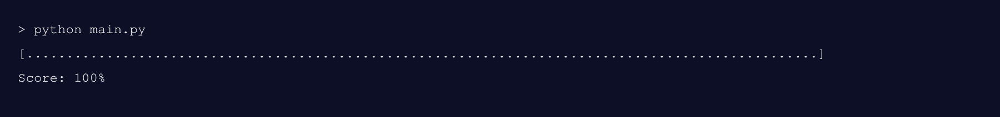
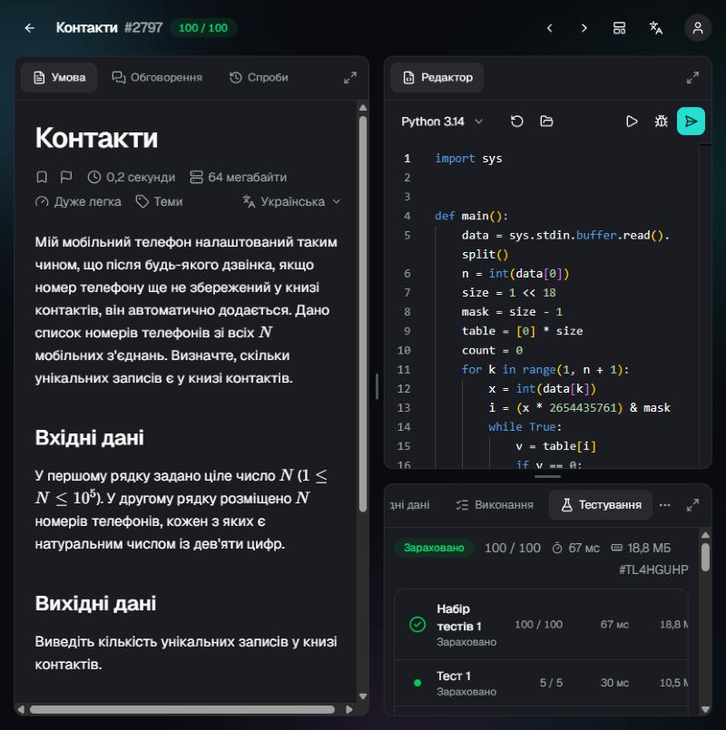
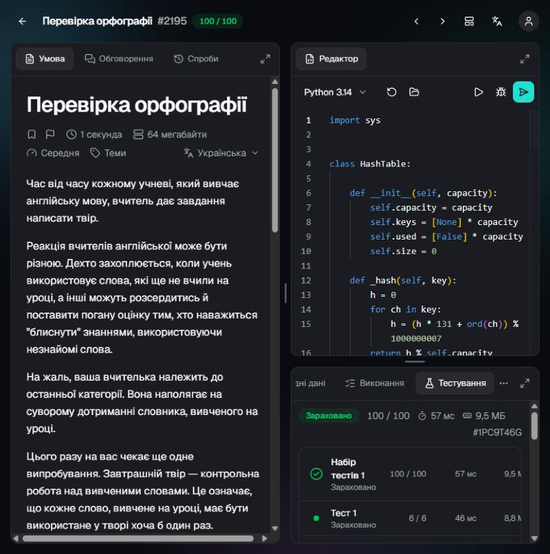

# Алгоритми і структури даних. Лабораторні роботи 6–7

В усіх задачах реалізовано власну хеш-таблицю з відкритою адресацією (лінійне зондування). Вбудовані `hash()`, `dict` і `set` не використовуються.

## Задача 6.3. Бібліотека художніх книг

Тестова програма: https://github.com/krenevych/algo/tree/master/labs/L06/task3

Код: [t06_03/user.py](t06_03/user.py) (у папці [t06_03](t06_03) також лежать `main.py` і `data/` з тестової програми)

Каталог зберігається у хеш-таблиці з відкритою адресацією: ключ — автор, значення — список його книг, відсортований за алфавітом. Хеш рядка обчислюється поліноміально: h = (h·31 + код символу) mod (10⁹ + 7), потім береться остача від ділення на розмір таблиці. Колізії розв'язуються лінійним зондуванням, видалені комірки позначаються спеціальним маркером. Коли таблиця заповнена більше ніж наполовину, її розмір подвоюється.

* `addBook` — знаходимо автора в таблиці та вставляємо назву у відсортований список (бінарний пошук позиції);
* `find` — знаходимо автора і бінарним пошуком перевіряємо наявність назви;
* `delete` — видаляємо назву зі списку; якщо книг автора не лишилось, видаляємо автора з таблиці;
* `findByAuthor` — повертаємо копію відсортованого списку книг автора.

Результат запуску `main.py`: **Score: 100%**

---

## Задача 7.3. Контакти
Eolymp: https://eolymp.com/uk/problems/2797

Код: [t07_03_e2797.py](t07_03_e2797.py)

Номери телефонів додаємо в хеш-таблицю розміром 2¹⁸ з відкритою адресацією. Хеш числа — мультиплікативний: (x · 2654435761) mod 2¹⁸. Якщо номер уже є в таблиці, він не додається вдруге. Відповідь — кількість доданих номерів.

Результат перевірки на Eolymp: **100%**

---

## Задача 7.4. Перевірка орфографії
Eolymp: https://eolymp.com/uk/problems/2195

Код: [t07_04_e2195.py](t07_04_e2195.py)

Слова словника (у нижньому регістрі) додаємо в хеш-таблицю з відкритою адресацією. Текст розбиваємо на слова — максимальні послідовності латинських літер, переводимо в нижній регістр і шукаємо кожне в таблиці, позначаючи знайдені слова як використані. Якщо якогось слова немає — текст містить невідомі слова; інакше перевіряємо, чи всі слова словника позначені.

Результат перевірки на Eolymp: **100%**

